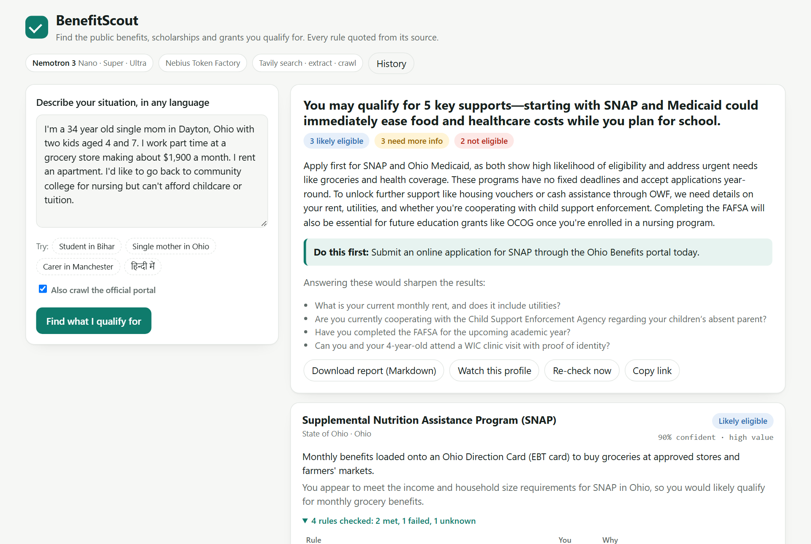

# BenefitScout

**Describe your situation in any language. BenefitScout finds the government benefits, scholarships and grants you qualify for, and shows you the rule, quoted from the source, behind every verdict.**

**Live demo: https://benefitscout.onrender.com** (free tier: the first visit after 15 idle minutes takes about a minute to wake).

Built for the Nebius x NVIDIA Global AI Hackathon, *Best Apps and Agents* track. Runs on **NVIDIA Nemotron 3** (Nano, Super and Ultra) on **Nebius Token Factory**, with **Tavily** for live search, crawl and extraction.

> *"I am a 20 year old girl from Gaya, Bihar. Second year BSc at a government college. Father is a farmer, family income about 2 lakh. SC category. 82% in class 12."*
>
> 90 seconds later: **Post-Matric Scholarship for SC students: eligible (95%)**, with all four rules met and quoted; the Bihar girls' 12th-pass incentive: likely; the BC/EBC scholarship: not eligible, because she is SC; a 11-18 girls' scheme: not eligible, because she is 20. Plus the documents to gather, the question that would unlock the central-sector scholarship, and a cost ledger: $0.05 of Nemotron, 45% less than running everything on Ultra.



## Why this exists

Billions in public benefits go unclaimed every year because people do not know a scheme exists, cannot tell whether they qualify, or give up on the paperwork. India alone runs more than 3,000 central and state schemes across hundreds of portals; the same is true, at smaller scale, of every country. The information is public. It is just scattered, written for administrators, and changes without notice.

BenefitScout is the caseworker most people never get: it reads the official pages for you, checks each rule against your facts, tells you what to apply for first, and keeps watching for new schemes and changed deadlines.

## How it works

Three Nemotron models, three kinds of work. Every call is tagged with its role so the app can show who did what and what it cost.

| Step | Who | What |
|---|---|---|
| 1. Profile | **Nemotron 3 Nano** | Turns free text in any language into a structured profile, and lists the facts that are missing. |
| 2. Plan | **Nemotron 3 Super** | Writes the research plan: official domains for this country and region, the portal to crawl, eight targeted queries. |
| 3. Search | **Tavily** search, crawl | Searches with official domains preferred (so NGO and university pages still appear, behind the government's). Crawls the national scheme portal with a natural-language instruction. |
| 4. Triage | **Nemotron 3 Super** | Reads up to 90 results and keeps the distinct schemes that could plausibly fit this person. |
| 5. Rules | **Tavily** extract, then **Nemotron 3 Super** | Extracts each scheme page and writes its rules down as typed criteria, each with a verbatim quote. If the official page is a JavaScript shell (myscheme.gov.in is), it finds the same scheme on a secondary source and labels it. |
| 6. Judge | **Nemotron 3 Ultra**, thinking on | For each scheme: does *this* person meet *each* rule? Meets, fails or unknown, with a reason, a verdict with confidence, the questions to ask, the next steps. |
| 7. Summary | **Nemotron 3 Super** (+ Super translation) | What to apply for first and why, the one thing to do today, the four questions that would change the picture. In the person's own language if they did not write in English. |
| 8. Watch | **Nemotron 3 Nano** | Re-check a saved profile on a schedule; Nano diffs the two runs and says whether anything needs action. |

The live activity panel shows every step as it happens: each Tavily query, each page, each verdict, and the running cost.

### Why the split, measured

We labelled 8 profiles (India, US, UK, Germany, Canada; students, a single mother, a carer, a farmer, a veteran, a pensioner) with 21 expected (scheme, verdict) pairs and ran the pipeline under six model assignments. Full table and every failure case, in the models' own words, in [docs/EVALS.md](docs/EVALS.md).

| Configuration | Triage | Rules | Verdicts | Expected schemes found | Verdict accuracy | Correct / 21 | Nemotron cost, 8 runs |
|---|---|---|---|---|---|---|---|
| **split (shipped)** | Super | Super | **Ultra** | 94% | 88% | **18** | $0.61 |
| judge on Super | Super | Super | Super | 94% | 62% | 14 | $0.27 |
| judge on Nano | Super | Super | Nano | 94% | 75% | 16 | $0.20 |
| triage on Nano (our first version) | Nano | Super | Ultra | 75% | 92% | 16 | $0.59 |
| rules on Nano | Super | Nano | Ultra | 88% | 93% | 18 | $0.52 |
| everything on Ultra | Ultra | Ultra | Ultra | 69% | 83% | 14 | $0.95 |

Ultra as the judge is what buys accuracy: the same pages judged by Super drop from 18 to 14 correct. Nano triage loses a quarter of the expected schemes before anyone judges them. And everything-on-Ultra is both the most expensive row and one of the worst: Ultra over-filters at triage (it dropped Medicaid and WIC for the Ohio mother, and PM-KISAN for the farmer), so the right-sized split beats the biggest model on accuracy and on cost. Rules on Nano looks competitive on this small set but surfaces fewer schemes; the shipped split keeps Super there.

Two things we learned and changed:

- **Triage was Nano's job at first.** It missed BAföG for a German student even though the Studentenwerk's BAföG page was in the crawl. Moving triage to Super costs a fraction of a cent per run and fixed it.
- **The judge was too cautious.** Ultra called "need more information" on procedural things (you will have to show the land record, the lender will run a credit check). We rewrote the calibration rules: procedural requirements are next steps, not unknowns; prerequisites that are themselves schemes are judged from the person's facts.

What still fails is listed in the evals doc. We would rather show it than hide it.

## Run it

```bash
git clone https://github.com/rupakkumar-76319/benefitscout
cd benefitscout
python -m venv .venv && . .venv/bin/activate        # Windows: .venv\Scripts\activate
pip install -r requirements.txt
cp .env.example .env                                  # add NEBIUS_API_KEY and TAVILY_API_KEY
uvicorn benefitscout.server:app --port 8000
```

Open http://localhost:8000. Or from the command line:

```bash
python -m benefitscout "I'm 52, live in Manchester, UK, and stopped working to look after my mother who has dementia..."
```

Docker:

```bash
docker build -t benefitscout . && docker run -p 7860:7860 --env-file .env benefitscout
```

The watcher, for cron or a Nebius Serverless Job:

```bash
python scripts/recheck.py            # one pass over every watched profile
python scripts/recheck.py --loop 24  # every 24 hours
```

Evals:

```bash
python evals/run_evals.py            # all six configurations -> docs/EVALS.md
```

### Configuration

| Variable | Default | Meaning |
|---|---|---|
| `NEBIUS_API_KEY` | | Nebius Token Factory key |
| `NEBIUS_BASE_URL` | `https://api.tokenfactory.nebius.com/v1` | OpenAI-compatible endpoint |
| `TAVILY_API_KEY` | | Tavily key |
| `BS_DATA_DIR` | `data` | Runs, watch list and caches |
| `BS_WEB_CACHE`, `BS_LLM_CACHE` | `1` | Disk caches for Tavily and model calls (set `0` to force fresh calls) |

Models are set in `benefitscout/llm.py` (`ROLES`). Prices used by the ledger are Token Factory list prices (USD per million tokens): Nano 0.06 / 0.24, Super 0.30 / 0.90, Ultra 1.00 / 3.00.

## What a run costs

Typical run (8 searches, one crawl, 10-14 pages extracted, 8-10 schemes judged): **$0.05 to $0.10 of Nemotron** and **11 to 21 Tavily credits**, 60 to 120 seconds. The same run with every role on Ultra costs 1.8x to 2x more; the ledger at the bottom of every result shows the exact numbers for that run.

## Honest limits

- BenefitScout reads what the web says today. Rules change, pages lag, and portals sometimes serve crawlers an error page. Every verdict links to the page it was read from, and secondary sources are labelled. Check before you apply.
- It is not legal or financial advice and it does not submit applications.
- It judges from what you told it. The "we still need to know" list is the fastest way to a better answer.
- Scheme coverage depends on what search can reach. Countries with strong official portals (gov.uk, canada.ca, benefits.gov) get the crawl; India relies on search because its portals are JavaScript apps.

## Repository

```
benefitscout/
  llm.py        Nemotron client, role -> model map, per-role ledger with the all-Ultra counterfactual
  web.py        Tavily search / extract / crawl / map with disk cache and credit accounting
  profile.py    Stage 1: free text -> profile (Nano)
  discover.py   Stage 2: research plan (Super), Tavily search + crawl, triage (Super)
  rules.py      Stage 3: page -> quoted criteria (Super), secondary-source fallback, de-duplication
  judge.py      Stage 4: criterion-by-criterion verdicts (Ultra), summary and translation (Super)
  pipeline.py   The run as a stream of events; re-check with diff
  store.py      Saved runs and the watch list (JSON files)
  server.py     FastAPI app: SSE stream, history, watch, re-check, Markdown export
  cli.py        python -m benefitscout "..."
web/            Single-page front end (no build step)
evals/          Labelled profiles and the model-assignment sweep
scripts/        recheck.py, the scheduled watcher
docs/           EVALS.md, screenshots
```

MIT licence. Built by Rupak Kumar during the hackathon, October 2026.
